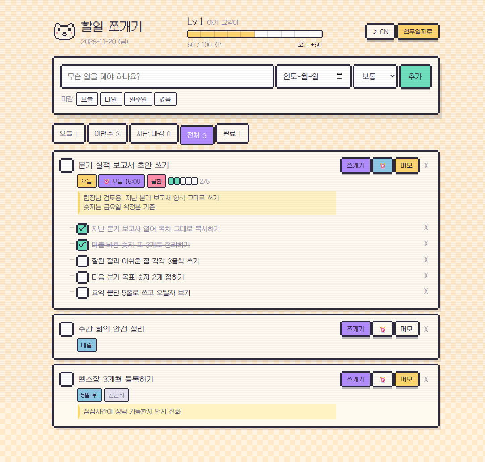

# 할일 쪼개기

"보고서 쓰기"처럼 막막한 업무를 버튼 한 번으로 15~60분짜리 실행 단위로 나눠 주는 투두리스트입니다.
Claude Code로 바이브코딩해서 만들었고 실제 업무에 쓰면서 기능을 하나씩 붙였습니다.



## 쓰기 전에 알아 둘 점

- 내 PC에 서버를 띄워 쓰는 로컬 앱입니다. 인터넷에 올려 둔 주소는 없어서 저장소를 받아 각자 PC에서 실행해야 합니다
- 할일과 메모는 그 PC 안의 파일에만 저장되고 밖으로 나가지 않습니다
- AI 쪼개기는 그 PC에 설치된 Claude Code CLI를 불러 씁니다. 그래서 Claude Code를 설치하고 로그인한 사람만 쪼개기 버튼을 쓸 수 있습니다
- 할일, 알림, 메모, 경험치 같은 나머지 기능은 Claude Code 없이도 됩니다

## 주요 기능

- **AI 쪼개기**: 업무 제목과 메모를 보내면 5~8개 하위 할일로 나눠 보여 줍니다. 마음에 드는 것만 골라 넣습니다
- **마감일 탭**: 오늘, 이번주, 지난 마감, 전체, 완료로 나눠 봅니다
- **알림**: 정한 시각에 컴퓨터 알림이 뜹니다. 급한 일은 확인을 누를 때까지 화면에 남습니다
- **아침 브리핑**: 매일 아침 오늘 마감인 일과 밀린 일을 창으로 띄웁니다
- **메모**: 할일마다 메모를 달 수 있고 쪼갤 때 메모가 설명으로 같이 넘어갑니다
- **경험치·레벨**: 할일을 끝낼 때마다 XP가 쌓이고 레벨이 오릅니다
- **업무일지 내보내기**: 오늘 끝낸 일을 마크다운으로 정리해 복사하거나 일지 파일에 넣습니다

## 만든 과정

8월에 AI 쪼개기와 마감일 목록으로 시작했습니다. 쓰다가 필요해진 기능을 차례로 붙였습니다.

- 9월: 정한 시각에 뜨는 알림
- 11월: 아침 브리핑, 경험치·레벨, 메모

## 기술

- Node.js 내장 모듈만 씁니다. 외부 패키지는 하나도 없습니다
- 화면은 프레임워크 없이 HTML, CSS, JavaScript로 만들었습니다
- 데이터는 PC 안의 JSON 파일에 저장합니다. 서버는 이 PC(127.0.0.1)에서만 열립니다
- AI 쪼개기는 PC에 로그인된 Claude Code CLI(`claude -p`)를 불러 처리합니다. 코드에 API 키가 없습니다
- 테스트 86개 (`npm test`)

## 시작하기

필요한 것

- Windows 10/11 또는 macOS ([맥에서 쓰기](#맥에서-쓰기) 참고)
- Node.js 18 이상
- Claude Code CLI 설치와 로그인 (쪼개기 버튼에 필요합니다)

```
git clone https://github.com/kidujm/todo-splitter.git
cd todo-splitter
node server.js
```

브라우저에서 `http://localhost:4321`이 열립니다. Windows에서는 `start.bat`, 맥에서는 `start.command`를 더블클릭해도 됩니다.

## 켜고 끄기

`start.bat`을 더블클릭하면 검은 창이 하나 뜨고 브라우저가 자동으로 열립니다.
끄고 싶으면 그 검은 창을 닫거나 `Ctrl+C`를 누르세요. 바탕화면에 `start.bat` 바로가기를 만들어 두면 편합니다.

주소는 `http://localhost:4321`입니다. 포트가 이미 쓰이고 있으면 4322, 4323… 순으로 비어 있는 번호를 찾아갑니다.

알림을 받으려면 서버가 켜져 있어야 합니다. 윈도우를 켤 때 자동으로 띄우려면 [자동 실행](#자동-실행)을 보세요.

## 맥에서 쓰기

맥에서도 같은 방법으로 받아서 씁니다. 할일, 쪼개기, 알림, 아침 브리핑이 모두 됩니다.

- **켜기**: Finder에서 `start.command`를 더블클릭하면 터미널이 열리고 브라우저가 뜹니다. 처음에는 "확인되지 않은 개발자" 경고가 나올 수 있는데, 파일을 우클릭해 `열기`를 누르면 됩니다. 더블클릭해도 안 열리면 터미널에서 `chmod +x start.command`를 한 번 실행하세요
- **끄기**: 터미널 창을 닫거나 `Ctrl+C`를 누릅니다
- **알림**: 보통·천천히 할일은 화면 오른쪽 위 알림으로, 급한 할일은 `확인`·`10분 뒤` 버튼이 있는 창으로 뜹니다. 알림이 안 보이면 `시스템 설정 > 알림`에서 `스크립트 편집기` 알림을 허용하세요
- **자동 실행**: `시스템 설정 > 일반 > 로그인 항목`에 `start.command`를 추가합니다. 로그인할 때 터미널 창이 함께 열립니다
- **아침 브리핑**: 터미널에서 `sh tools/install-mac-briefing.sh`를 한 번 실행하면 매일 09:00과 로그인 때 뜹니다. 그만두려면 `--remove`를 붙여 다시 실행하세요

## 쪼개기 버튼

할일 카드의 **[쪼개기]**를 누르면:

1. 부가 설명을 덧붙일 수 있는 창이 뜹니다 (비워도 됩니다)
2. 컴퓨터에 설치된 `claude` CLI가 실행돼 그 업무를 15~60분짜리 실행 단위 5~8개로 나눕니다
3. 결과를 **먼저 보여드립니다.** 원하는 항목만 골라서 추가하세요. 자동으로 들어가지 않습니다

한 번에 10~20초 걸립니다. API 키는 필요 없고, 이미 로그인된 `claude` 명령을 그대로 씁니다.

`claude` 명령을 못 찾으면 창 안에 그 사실이 뜹니다. 터미널에서 `claude`를 쳤을 때 실행되는지 확인해 보세요.
다른 위치에 설치했다면 환경변수 `CLAUDE_BIN`에 실행 파일 경로를 넣어 주면 됩니다.

## 알림

할일 카드의 **⏰** 버튼을 누르면 날짜와 시각을 정할 수 있습니다. 그 시각이 되면 컴퓨터에 팝업이 뜹니다.

- **보통·천천히** 할일은 우측 하단 토스트로 조용히 뜹니다. 알림 센터에도 남습니다
- **급함** 할일은 화면 가운데 창으로 뜹니다. `확인`이나 `10분 뒤`를 누를 때까지 사라지지 않습니다
- `10분 뒤`를 누르면 알림이 10분 뒤로 미뤄집니다

`30분 뒤`·`1시간 뒤`·`3시간 뒤`·`내일 9시` 칩으로 빠르게 채울 수 있습니다. 마감일이 있는 할일은 창을 열면
그날 오전 9시가 기본으로 잡힙니다. 지난 시각은 고를 수 없습니다.

알림을 맞춰 둔 카드에는 `⏰ 9/5 14:00` 배지가 붙습니다. 이미 울린 알림은 회색으로 흐려집니다.
알림을 끄려면 창에서 `알림 끄기`를 누르세요.

서버는 30초마다 확인합니다. 그래서 실제 팝업은 정한 시각보다 최대 30초 늦게 뜰 수도 있습니다.

### 서버가 꺼져 있던 사이

지나간 알림은 서버를 켜면 바로 알려 줍니다. 다만 **12시간이 넘은 알림은 조용히 넘어갑니다.**
주말 내내 컴퓨터를 꺼 뒀다가 켰을 때 묵은 팝업이 쏟아지지 않게 하려는 것입니다.

### 자동 실행

알림은 서버가 켜져 있을 때만 울립니다. 윈도우를 켤 때마다 서버가 뜨게 하려면:

1. `Win+R`에 `shell:startup`을 쳐서 시작프로그램 폴더를 엽니다
2. 그 폴더에 `start-silent.vbs` 바로가기를 만듭니다. 검은 창 없이 서버만 띄우고, 브라우저는 열지 않습니다
3. 기록은 `data/server.log`에 남습니다. 창이 없으니 문제가 생기면 여기를 보세요

끄고 싶으면 `stop.bat`을 더블클릭하세요. 자동 실행을 그만두려면 시작프로그램 폴더에서 바로가기를 지우면 됩니다.

화면을 보고 싶을 때는 브라우저에서 `localhost:4321`을 여세요.

### 알림이 안 뜬다면

Windows 설정에서 알림 자체가 꺼져 있을 수 있습니다. `설정 → 시스템 → 알림`을 확인해 보세요.
집중 지원(방해 금지)이 켜져 있어도 토스트가 안 보입니다.

내부적으로는 Windows PowerShell 5.1을 거쳐 알림을 띄웁니다. PowerShell 7(`pwsh`)로는 안 됩니다.
7에서는 알림 API를 못 불러옵니다. 경로를 바꾸고 싶으면 환경변수 `TODO_POWERSHELL`에 넣으면 됩니다.


## 아침 브리핑

매일 아침 화면 가운데에 "오늘 꼭 해야 합니다" 창이 뜹니다. 마감일이 오늘인 할일, 마감이 지났는데 안 끝낸 할일,
다음 일정 4개를 보여 줍니다. 앱에서 체크한 하위 할일은 빠집니다.

- 작업 스케줄러에 `tools/briefing.vbs`를 매일 09:00과 로그온 때 실행하도록 등록하면 됩니다
- 하루에 한 번만 뜹니다 (`data/briefing-last.txt`에 마지막 날짜를 적어 둡니다). 09:00에 컴퓨터가 꺼져 있었으면 켠 뒤에 뜹니다
- 마감일 있는 할일이 하나도 없으면 뜨지 않습니다
- 바로 다시 보려면 `node tools/briefing.js --force`
- 안 뜨면 `data/briefing.log`를 보세요
- 그만두려면 `작업 스케줄러`에서 등록한 작업을 지우세요

창은 다른 창 위에 고정돼 있습니다. 백그라운드에서 띄운 창은 포커스를 못 가져가서, 고정을 풀면 다른 창 뒤로 숨기 때문입니다.

## 메모

할일 카드의 **[메모]**를 누르면 메모 창이 뜹니다. 줄바꿈도 그대로 남고, 최대 2000자까지 적을 수 있습니다.

- 저장하면 카드 제목 아래에 노란 칸으로 보입니다. 길면 세 줄까지만 보이고, 누르면 다시 창이 열립니다
- 메모가 있는 카드는 [메모] 버튼이 노란색으로 바뀝니다
- `Ctrl+Enter`로 바로 저장되고, `메모 지우기`로 비울 수 있습니다
- 끝낸 할일에도 메모를 달거나 고칠 수 있습니다
- 쪼개기 창의 '덧붙일 설명'과 같은 칸입니다. 메모를 적어 두면 쪼갤 때 그 내용이 설명으로 들어가고, 쪼개기 창에서 설명을 고치면 메모도 같이 바뀝니다

## 경험치·레벨

할일을 끝낼 때마다 XP가 쌓이고, 오른쪽 위 바가 다 차면 레벨이 오릅니다. 레벨이 오르면 고양이가 축하 창을 띄웁니다.

| 끝낸 것 | XP |
|---|---|
| 하위 할일 | 10 |
| 할일 (천천히 / 보통 / 급함) | 15 / 20 / 30 |
| 마감일 당일이나 그 전에 끝냄 | +10 |

- 다음 레벨까지 필요한 XP는 100에서 시작해 레벨마다 50씩 늘어납니다
- 체크를 풀면 받았던 XP도 돌려놓습니다. 끝낸 할일을 지워도 XP는 남습니다
- 바 아래 `오늘 +N`은 오늘 번 XP입니다. 바에 마우스를 올리면 총 XP와 규칙이 보입니다
- 칭호는 Lv.1 아기 고양이부터 Lv.20 전설의 고양이까지 일곱 단계입니다
- 처음 켤 때 그동안 끝낸 기록으로 시작 레벨을 계산합니다

## 업무일지 연동

오른쪽 위 **[업무일지로]**를 누르면 오늘 끝낸 일이 마크다운으로 정리됩니다.

- **복사**: 클립보드로 가져갑니다
- **WorkLog에 기록**: `Documents\WorkLog\Daily\{날짜}.md`의 `## ✅ 오늘 한 일`과 `## 🔄 진행 중 · 대기` 항목 아래에 끼워 넣습니다

기존에 적어 둔 내용은 지우지 않습니다. 비어 있는 `- [ ]` 껍데기만 정리합니다.
그날 노트가 아직 없으면 새로 만듭니다.

## 데이터

할일은 전부 `data/todos.json` 한 파일에, XP 장부는 `data/game.json`에 들어갑니다. 저장할 때마다 직전 상태를 `data/todos.bak.json`에 남기므로,
파일이 깨져도 백업본으로 자동 복구합니다. 백업하고 싶으면 `data` 폴더만 복사하면 됩니다.

서버는 `127.0.0.1`에만 붙습니다. 같은 공유기에 있는 다른 기기에서도 열리지 않습니다.

`data` 폴더는 `.gitignore`에 들어 있어 저장소에 올라가지 않습니다.

### 다른 웹페이지에서 쪼개기 부르기

다른 곳에 올린 웹페이지가 이 PC의 쪼개기를 부르게 하려면 `config.example.json`을 `config.local.json`으로 복사하고
`allowedOrigins`에 그 페이지의 `https://` 주소를 적습니다. 그 주소에는 서버 상태 확인과 쪼개기만 열리고, 할일 목록은 열리지 않습니다.
`config.local.json`도 저장소에 올라가지 않습니다.

## 화면 사용법

| 하고 싶은 것 | 방법 |
|---|---|
| 할일 추가 | 위쪽 입력창에 쓰고 Enter |
| 마감일 빠르게 정하기 | 입력창 아래 `오늘`·`내일`·`일주일` 칩 |
| 제목 고치기 | 제목을 클릭 → 고치고 Enter (Esc는 취소) |
| 삭제 | `X` → `정말?`로 바뀌면 한 번 더 |
| 알림 맞추기 | 카드의 `⏰` → 날짜·시각 지정 |
| 메모 달기 | 카드의 `메모` → 적고 저장 (Ctrl+Enter) |
| 효과음 끄기 | 오른쪽 위 `♪ ON` |

하위 할일을 전부 체크하면 본 할일도 함께 완료로 넘어갑니다.

## 파일 구조

```
server.js         HTTP 서버 + 라우팅
lib/store.js      todos.json 읽기·쓰기, 들어온 값 정리
lib/filters.js    오늘·이번주·지난 마감 분류 (서버와 브라우저가 같이 씀)
lib/splitter.js   claude CLI 호출 + 응답 해석
lib/worklog.js    완료 항목 → 마크다운, 데일리 노트 병합
lib/game.js       XP·레벨 규칙과 장부 (서버와 브라우저가 같이 씀)
lib/notifier.js   알림 시각 감시 루프, 울림 표시 관리
lib/popup.js      알림 팝업 (Windows는 PowerShell 5.1, 맥은 osascript)
public/           화면 (index.html, style.css, app.js)
tools/make-icon.js  픽셀 아이콘(icon.ico) 생성기
tools/briefing.js   아침 브리핑 창 (Windows는 briefing.vbs가 창 없이 실행)
tools/install-mac-briefing.sh  맥 아침 브리핑 자동 실행 등록 (launchd)
start-silent.vbs  창 없이 서버 실행 (자동 실행용, UTF-16LE로 저장할 것)
stop.bat          서버 종료 (stop.ps1 호출)
start.command     맥 실행 파일 (Finder에서 더블클릭)
config.example.json  외부 웹페이지 허용 주소 예시 (config.local.json으로 복사해 씀)
docs/             README용 화면 캡처
test/             단위 테스트
```

## 테스트

```
npm test
```

날짜 분류, 데일리 노트 병합, AI 응답 해석, 알림 시각 판정, XP 계산, 맥 알림 스크립트 86개를 검사합니다.

## 손보고 싶을 때

- **색·크기**: `public/style.css` 맨 위 `:root` 변수만 바꾸면 전체가 따라갑니다
- **마스코트 고양이**: `public/app.js`의 `CAT.rows`. 글자 한 개가 1픽셀입니다 (`b` 선, `w` 몸, `p` 볼)
- **XP·레벨·칭호**: `lib/game.js` 맨 위 `XP`, `needFor()`, `TITLES`
- **쪼개는 방식**: `lib/splitter.js`의 `PROMPT_HEADER`. 개수나 크기 기준을 여기서 바꾸면 됩니다
- **알림 확인 주기·묵은 알림 기준**: `lib/notifier.js`의 `TICK_MS`(30초), `STALE_MS`(12시간), `SNOOZE_MIN`(10분)
- **팝업 생김새**: `lib/popup.js`의 `windowScript()`. 색·크기·버튼을 여기서 바꿉니다
- **바로가기 아이콘**: `tools/make-icon.js`의 `MAP`. 여기도 글자 한 개가 1픽셀입니다
  (`b` 테두리, `L` 배경, `w` 얼굴, `p` 볼, `_` 투명). 고친 뒤 `node tools/make-icon.js`를 돌리면
  `icon.ico`가 다시 만들어집니다. 바탕화면 아이콘이 바로 안 바뀌면 F5로 새로 고치세요
